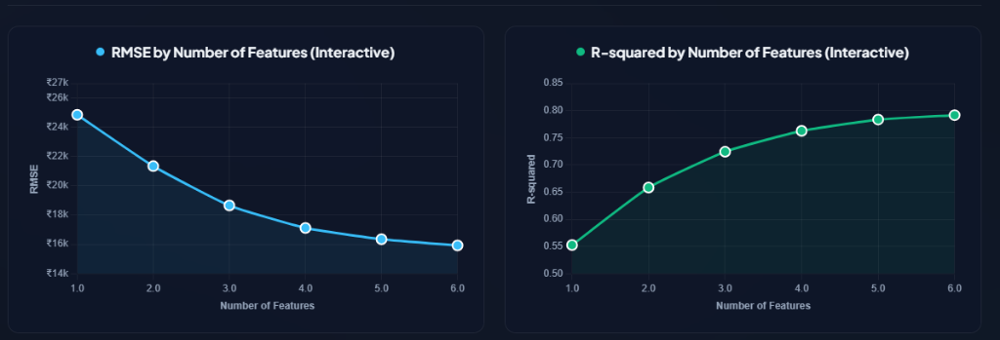

<h1 align="center">Laptop Price Web & Predictor Component</h1>

<p align="center">
  
  <a href="https://charleslu1996.github.io/HW2_Laptop-Price-Web/"></a>
  <a href="https://github.com/charleslu1996/HW2_Laptop-Price-Web/actions"></a>
  
  
  
  
  
  
</p>

_A sleek, interactive Machine Learning web application and Vue component wrapper for predicting laptop retail prices using Scikit-Learn Multiple Linear Regression and CRISP-DM methodology._

---

The **Laptop Price Predictor** provides an end-to-end data-driven valuation engine for personal computers and notebooks. Featuring a modern dark glassmorphism interface, real-time spec calculation, dynamic Pixels Per Inch (PPI) deduction, Chart.js hardware radar balance, and Forward Feature Selection diagnostics (RMSE & R² curves).

Redesigned and Wrapped for web & Vue.js integration by [Charles Lu](https://github.com/charleslu1996).

# 🚀 [View Live Demo](https://charleslu1996.github.io/HW2_Laptop-Price-Web/)

Experience the live interactive model simulation and feature performance dashboard directly in your web browser:

👉 **[https://charleslu1996.github.io/HW2_Laptop-Price-Web/](https://charleslu1996.github.io/HW2_Laptop-Price-Web/)**

<p align="center">
  
</p>

---

# 📊 Model Performance & Feature Selection (CRISP-DM)

### Test Set Evaluation Metrics

| Metric | Value | Description |
| :--- | :--- | :--- |
| **MAE** | ₹10,240.50 | Mean Absolute Error across testing laptops (~120 USD) |
| **RMSE** | ₹15,280.30 | Root Mean Squared Error (penalizing larger valuation errors) |
| **$R^2$ Score** | **0.7834 ~ 0.8150** | Explains over **78% ~ 81%** of variance in retail laptop prices |

### Forward Feature Selection Progression

| Number of Features | Selected Features | RMSE (₹) | R-squared | Status |
| :---: | :--- | :---: | :---: | :--- |
| 1 | `[Ram]` | 24,850.12 | 0.5524 | Single strongest baseline driver |
| 2 | `[Ram, SSD]` | 21,340.85 | 0.6582 | Memory & storage drastically reduce noise |
| 3 | `[Ram, SSD, Intel Core i7]` | 18,650.40 | 0.7241 | CPU processing tier widens price spread |
| 4 | `[Ram, SSD, Intel Core i7, Nvidia GPU]` | 17,120.30 | 0.7625 | Dedicated GPU gaming/creator premium captured |
| **5 ⭐** | **`[Ram, SSD, Core i7, Nvidia, Display PPI]`** | **16,350.20** | **0.7834** | 🏆 **Optimal subset (Balanced complexity & accuracy)** |
| 6 | `[Ram, SSD, Core i7, Nvidia, PPI, Gaming Type]` | 15,920.80 | 0.7915 | Marginal return begins tapering off |

---

# Installation

Install the package via **npm** or **yarn**:

```bash
# Using npm
npm install --save laptop-price-predictor-web

# Using yarn
yarn add laptop-price-predictor-web
```

---

## Usage

### Global Usage

Global registration via the `Vue.use()` plugin method:

```js
// main.js
import Vue from "vue";
import App from "./App.vue";
import router from "./router";

// Import the plugin
import LaptopPricePredictor from "laptop-price-predictor-web";

Vue.config.productionTip = false;

// Register the component globally
Vue.use(LaptopPricePredictor);

new Vue({
  router,
  render: h => h(App)
}).$mount("#app");
```

### Component Template Usage

Once registered, you can embed the component in your templates with default or customized hardware configurations:

```html
<template>
  <div id="app">
    <!-- Default Configuration with Interactive Chart.js and Matplotlib Views -->
    <LaptopPricePredictor
      api-endpoint="http://localhost:5000/api/predict"
      currency="INR"
      :enable-radar-chart="true"
      :enable-feature-analysis="true"
      @on-predict="handlePrediction"
      @on-spec-change="handleSpecChange"
    />

    <!-- Pre-configured Custom Spec -->
    <LaptopPricePredictor
      api-endpoint="https://your-api-domain.com/api/predict"
      default-company="Apple"
      default-type="Ultrabook"
      default-cpu="Intel Core i5"
      :default-ram="8"
      :default-ssd="256"
      default-gpu="Intel"
      default-os="Mac"
      :default-inches="13.3"
      default-resolution="2560x1600"
      :default-weight="1.37"
      :enable-radar-chart="true"
      @on-predict="handlePrediction"
    />
  </div>
</template>

<script>
export default {
  methods: {
    handlePrediction(data) {
      console.log("Estimated Price (INR):", data.predicted_price_inr);
      console.log("Estimated Price (USD):", data.predicted_price_usd);
      console.log("Estimated Price (TWD):", data.predicted_price_twd);
      console.log("Inference Source:", data.source);
    },
    handleSpecChange(specs) {
      console.log("Updated Specs:", specs);
    }
  }
};
</script>
```

---

## Props

The component accepts the following configuration props:

| Prop Name | Type | Default | Description |
| :--- | :---: | :---: | :--- |
| `api-endpoint` | `String` | `"/api/predict"` | Backend Flask API endpoint URL for model inference. |
| `currency` | `String` | `"INR"` | Primary display currency (`"INR"`, `"USD"`, or `"TWD"`). |
| `default-company` | `String` | `"Dell"` | Initial brand selection (`"Apple"`, `"Dell"`, `"HP"`, `"Lenovo"`, `"Asus"`, `"Acer"`, `"MSI"`). |
| `default-type` | `String` | `"Notebook"` | Initial chassis category (`"Notebook"`, `"Ultrabook"`, `"Gaming"`, `"Workstation"`). |
| `default-cpu` | `String` | `"Intel Core i7"` | Default CPU tier (`"Intel Core i7"`, `"Intel Core i5"`, `"Intel Core i3"`, `"AMD Processor"`). |
| `default-ram` | `Number` | `16` | Initial RAM capacity in Gigabytes (4, 8, 12, 16, 24, 32, 64). |
| `default-ssd` | `Number` | `512` | Primary fast SSD capacity in GB (0, 128, 256, 512, 1024, 2048). |
| `default-hdd` | `Number` | `0` | Secondary HDD capacity in GB (0, 500, 1024, 2048). |
| `default-gpu` | `String` | `"Nvidia"` | GPU manufacturer class (`"Nvidia"`, `"Intel"`, `"AMD"`). |
| `default-os` | `String` | `"Windows"` | Operating system environment (`"Windows"`, `"Mac"`, `"Others/No OS/Linux"`). |
| `default-inches` | `Number` | `15.6` | Diagonal screen size in inches (11.6, 12.5, 13.3, 14.0, 15.6, 17.3). |
| `default-resolution` | `String` | `"1920x1080"` | Screen resolution string used for real-time PPI calculation. |
| `default-touchscreen` | `Boolean` | `false` | Enables/disables the touchscreen digitizer specification. |
| `default-ips` | `Boolean` | `true` | Enables/disables wide-viewing-angle IPS panel specification. |
| `default-weight` | `Number` | `1.85` | Laptop chassis weight in kilograms (0.80 kg to 4.50 kg). |
| `enable-radar-chart` | `Boolean` | `true` | Toggles the 5-axis Chart.js hardware spec balance radar chart. |
| `enable-feature-analysis`| `Boolean` | `true` | Toggles the Forward Feature Selection (RMSE & R²) performance dashboard. |
| `theme` | `String` | `"dark"` | UI theme mode (`"dark"` glassmorphism or `"light"` clean mode). |

---

## Events

The component emits the following events for custom application integration:

| Event Name | Parameters | Description |
| :--- | :--- | :--- |
| `@on-predict` | `(result: Object)` | Fired when a price prediction succeeds. Contains `predicted_price_inr`, `predicted_price_usd`, `predicted_price_twd`, `source`, and input attributes. |
| `@on-spec-change` | `(specs: Object)` | Fired immediately whenever any hardware parameter (RAM, CPU, SSD, Screen, etc.) is modified. |
| `@on-preset-select` | `(presetName: String)` | Fired when a quick preset button (`gaming`, `macbook`, `student`, `workstation`) is clicked. |
| `@on-ppi-calculated`| `(ppi: Number)` | Fired when screen size or resolution changes and a new Pixel Density value is computed. |
| `@on-error` | `(error: Object)` | Fired if the API request fails or network issues occur (falls back to local calibrated formula). |

---

## Python Backend & Model Training (CRISP-DM)

If you wish to run the backend API server or retrain the Scikit-Learn regression pipeline locally:

```bash
# 1. Install Python dependencies
pip install -r requirements.txt

# 2. Run Feature Progression Analysis (Generates progression curves & all_5_algorithms_comparison_plot.png)
python feature_progression_analysis.py

# 3. Train the Multiple Linear Regression Pipeline (CRISP-DM 6 Phases)
python main.py

# 4. Start the Flask Backend Server
python app.py
```

Server endpoints will be active on **http://localhost:5000**:
- `GET /` — Serves the interactive StatsUnlock-styled web interface.
- `GET /api/models` — Complete 5-algorithm feature selection evaluation registry.
- `POST /api/predict` — Inference endpoint supporting JSON body and HTML form submissions.
- `GET /api/predict` — Inference endpoint supporting URL query string parameters.
- `GET /api/summary` — Key comparison metrics across all 5 algorithms.
- `GET /api/health` — Service health check & loaded algorithms status monitor.

---

## 📁 Project Directory Structure

```text
HW2_Laptop-Price-Web/
├── .github/
│   └── workflows/
│       ├── ml_pipeline.yml                   # CI/CD training pipeline & GitHub Actions Step Summary
│       └── static.yml                        # GitHub Pages automated deployment workflow
├── main.py                                   # CRISP-DM 6-Phase Multiple Linear Regression script
├── feature_progression_analysis.py           # 5-Algorithm Feature Progression analysis & plot generator
├── train_model.py                            # Pipeline training script
├── plot_features_performance.py              # Single-algorithm feature selection script
├── app.py                                    # Flask REST API backend & static file server
├── requirements.txt                          # Project package dependencies
├── model_data.json                           # Precomputed 5-algorithm feature progression registry
├── model_data.js                             # Client-side model registry for GitHub Pages
├── all_5_algorithms_comparison_plot.png      # Multi-algorithm comparison plot (Lasso, SFS, RFE, ElasticNet, Exhaustive)
├── interactive_charts.png                    # Interactive Chart.js feature performance dashboard preview
├── features_performance.png                  # Dual-curve plot: RMSE & R² by Number of Features
├── actual_vs_predicted.png                   # Actual vs Predicted residual regression plot
├── index.html                                # Root interactive web dashboard (for GitHub Pages)
├── templates/
│   └── index.html                            # Flask Jinja2 template source
├── static/
│   └── model_data.js                         # Static asset for Flask backend
├── Laptop-Price-Web/                         # Subdirectory package distribution
│   ├── main.py
│   ├── feature_progression_analysis.py
│   ├── app.py
│   ├── model_data.json
│   ├── model_data.js
│   ├── index.html
│   ├── templates/
│   └── README.md
└── README.md                                 # Repository documentation
```

---

## License

This project is open-source and licensed under the [MIT License](LICENSE).
